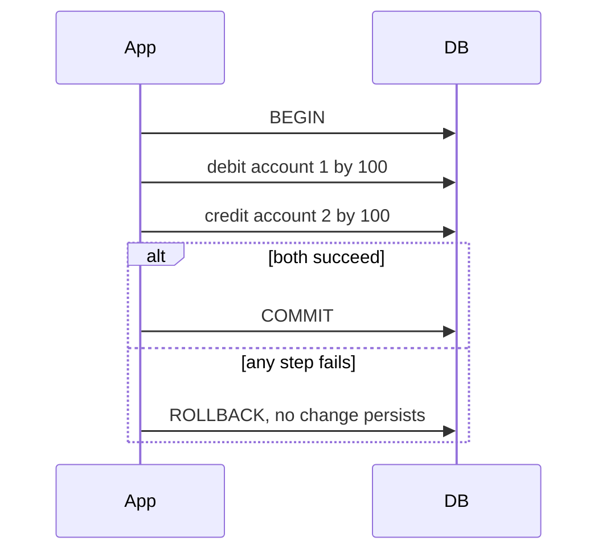

## Beginner-friendly explanation

Think of a bank vault with strict rules: every box has a unique number, every deposit slip must name a real account holder, and if a transfer between boxes is interrupted, the money must go back to where it started.

Database testing checks that those vault rules exist and really work. It is not only about whether the screen shows the right number; it is about whether the place where the data is kept refuses bad data, survives failures and stays consistent, no matter which program writes to it.

## Technical explanation

### Constraints

| Constraint | Rule | Deliberate violation to test |
|---|---|---|
| `PRIMARY KEY` | Unique and not NULL identifier | Insert a second row with the same id |
| `FOREIGN KEY` | Value must exist in the referenced table | Insert an order for a non-existent customer; delete a customer who has orders |
| `UNIQUE` | No duplicate values | Insert the same email twice, also in different letter case |
| `NOT NULL` | Value required | Insert without the column |
| `CHECK` | Row satisfies a condition | Insert a negative amount |
| `DEFAULT` | Value used when none supplied | Insert without the column and read it back |

For foreign keys, also test the `ON DELETE` behaviour (`RESTRICT`, `CASCADE`, `SET NULL`): is it what the business wants?

### Transactions and ACID

- **Atomicity:** all of a transaction's changes happen, or none do.
- **Consistency:** a transaction moves the database from one valid state to another; constraints hold.
- **Isolation:** concurrent transactions do not see each other's partial work in ways the isolation level forbids. SQL defines Read Uncommitted, Read Committed, Repeatable Read and Serializable; PostgreSQL's default is Read Committed.
- **Durability:** once committed, changes survive crashes.



### Data integrity beyond constraints

Some rules span tables or time and cannot be a simple constraint: an order total must equal the sum of its lines, a ledger must balance to zero, a soft-deleted user must have no active sessions. Express each rule as a query that returns violations.

### Other objects to test

Stored procedures, functions, triggers, views and indexes. Triggers deserve special attention because they change data silently, for example updating an `updated_at` column or writing an audit row.

### Migrations

A migration changes the schema or data from one version to the next. Risks: data loss, legacy rows violating new constraints, long locks on large tables, application incompatibility during a rolling deploy, and missing rollback.

## Code examples

A test schema in PostgreSQL:

```sql
CREATE TABLE accounts (
  id      integer PRIMARY KEY,
  owner   text    NOT NULL,
  email   text    NOT NULL UNIQUE,
  balance numeric(12,2) NOT NULL DEFAULT 0 CHECK (balance >= 0)
);

CREATE TABLE transfers (
  id         serial PRIMARY KEY,
  from_id    integer NOT NULL REFERENCES accounts(id),
  to_id      integer NOT NULL REFERENCES accounts(id),
  amount     numeric(12,2) NOT NULL CHECK (amount > 0)
);
```

Constraint tests, each expected to fail:

```sql
INSERT INTO accounts (id, owner, email) VALUES (1, 'Asha', 'asha@example.com'); -- setup, succeeds
INSERT INTO accounts (id, owner, email) VALUES (2, 'Ben', 'asha@example.com');  -- duplicate email
INSERT INTO accounts (id, owner, email, balance) VALUES (3, 'Chen', 'c@example.com', -5);
INSERT INTO transfers (from_id, to_id, amount) VALUES (1, 42, 10);             -- no account 42
```

## Expected output

PostgreSQL names unnamed constraints by convention, so the errors look like this (wording can vary slightly by version):

```text
ERROR:  duplicate key value violates unique constraint "accounts_email_key"
ERROR:  new row for relation "accounts" violates check constraint "accounts_balance_check"
ERROR:  insert or update on table "transfers" violates foreign key constraint "transfers_to_id_fkey"
```

Each test passes only if the statement is rejected **and** the table is unchanged afterwards.

## Real-world example

A loyalty-points service awarded points in two steps: insert a points transaction, then update the customer's balance. The steps ran in separate transactions. During a database failover, some inserts committed but the balance updates did not. Customers saw points in their history that were missing from their balance. Testers had verified the happy path thoroughly but had never forced a failure between the steps. A test that killed the connection after the first statement exposed the issue, and the fix wrapped both steps in a single transaction.

## Step-by-step walkthrough

1. **Read the schema** and list every constraint, trigger and integrity rule.
2. **Map each rule to the business requirement**, and flag mismatches, such as a case-sensitive unique email when the business treats emails case-insensitively.
3. **Write one violation per constraint**, run it in a transaction, check the error, then roll back.
4. **Test transactions** by injecting failures between steps and verifying no partial state.
5. **Test concurrency** for critical rules, such as two parallel withdrawals against the same balance.
6. **Write integrity queries** for cross-table rules and add them to regression.
7. **For migrations**, run forward on a realistic data copy, verify counts and samples, test rollback or the forward-fix plan, and time it.

## Common mistakes

- **Testing only through the UI**, so missing constraints go unnoticed.
- **Testing migrations on empty or tiny seed data.**
- **Checking the error but not the table state** after a rejected operation.
- **Ignoring concurrency**, where two requests both pass an application-level check.
- **Experimenting on shared or production data** instead of an isolated test database.
- **Forgetting triggers and defaults**, which change data you did not explicitly write.

## Troubleshooting

- **A violation was not rejected.** Check whether the constraint exists in this environment; migrations may not have run, or the constraint may be marked `NOT VALID`.
- **Test leaves data behind.** Run each test inside a transaction and roll back, or recreate the schema per run.
- **Concurrency test is not reproducible.** Use two explicit sessions and control the order of statements step by step.

## Key takeaways summary

Database testing proves that the rules protecting your data are real. Violate every constraint on purpose, force failures inside transactions, express cross-table rules as violation queries, and test migrations on realistic data with a way back.
