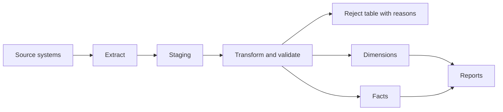

## Beginner-friendly explanation

Imagine moving house. Boxes are packed at the old house (extract), some things are repacked or relabelled on the way (transform), and everything is unpacked into the new house (load). Afterwards, you want to know: did every box arrive? Did anything break? Is everything in the right room?

ETL testing asks the same questions about data. Data is copied from source systems, cleaned and reshaped, then loaded into a **data warehouse** used for reports and decisions. If a row goes missing or a number is transformed wrongly, the reports quietly become wrong, and people make decisions on bad numbers.

## Technical explanation

**ETL** stands for Extract, Transform, Load. In **ELT**, raw data is loaded first and transformed inside the warehouse; the testing ideas are the same. A warehouse typically uses a **dimensional model**: **fact** tables hold measurable events (sales, payments) and **dimension** tables hold descriptive context (customer, product, date). Dimensions use **surrogate keys** generated by the warehouse, separate from source **business keys**.



### Source-to-target mapping (STTM)

The mapping document is the tester's main oracle. Each row defines a target column, its source, and the rule.

| Target column | Source | Rule | Example test |
|---|---|---|---|
| `dim_customer.full_name` | `crm.first_name`, `crm.last_name` | Trim, join with one space | `'  Asha '` + `'Rao'` gives `'Asha Rao'` |
| `dim_customer.country_code` | `crm.country` | Map names to ISO 3166 alpha-2 | `'India'` gives `'IN'`; unknown goes to reject table |
| `fact_sales.amount` | `pos.amount_cents` | Divide by 100, two decimals | `1999` gives `19.99` |
| `fact_sales.date_key` | `pos.sold_at` | Store-local date as `YYYYMMDD` | Sale at 23:30 local stays on that date |

### Reconciliation techniques

| Technique | What it proves | Blind spot |
|---|---|---|
| Row counts | Volume matches: source = loaded + rejected | Offsetting errors, wrong values |
| Aggregate checksums | Totals agree per day or category | Errors that cancel out within a group |
| Set difference (`EXCEPT`) on keys | Exactly which rows are missing or extra | Value differences on matched keys |
| Column-level comparison or row hashes | Values match for matched keys | Needs both sides accessible |

### Slowly changing dimensions (SCD)

| Type | Behaviour |
|---|---|
| Type 0 | Keep the original value; ignore changes |
| Type 1 | Overwrite; no history |
| Type 2 | Close the current row, insert a new version with a new surrogate key |
| Type 3 | Keep the previous value in an extra column |

Type 2 example after customer 42 moves from Pune to Mumbai on 1 March 2026:

| customer_sk | customer_id | city | valid_from | valid_to | is_current |
|---|---|---|---|---|---|
| 1001 | 42 | Pune | 2024-05-10 | 2026-02-28 | N |
| 1057 | 42 | Mumbai | 2026-03-01 | 9999-12-31 | Y |

### Data quality dimensions

Commonly used dimensions: **completeness** (required data present), **validity** (conforms to format and allowed values), **accuracy** (matches reality or a trusted source), **consistency** (agrees across systems and tables), **uniqueness** (no unintended duplicates) and **timeliness** (available when needed). Each needs a measurable check and a threshold agreed with the data owner.

## Code examples

```sql
-- Count reconciliation for one business date
SELECT
  (SELECT COUNT(*) FROM staging_sales  WHERE sale_date = DATE '2026-03-01') AS source_rows,
  (SELECT COUNT(*) FROM fact_sales     WHERE date_key  = 20260301)          AS loaded_rows,
  (SELECT COUNT(*) FROM reject_sales   WHERE sale_date = DATE '2026-03-01') AS rejected_rows;

-- Aggregate checksum per store
SELECT store_id, SUM(amount_cents) / 100.0 AS source_total
FROM staging_sales WHERE sale_date = DATE '2026-03-01' GROUP BY store_id
EXCEPT
SELECT store_id, SUM(amount) FROM fact_sales WHERE date_key = 20260301 GROUP BY store_id;

-- SCD Type 2: exactly one current row per business key
SELECT customer_id, COUNT(*) FROM dim_customer
WHERE is_current = 'Y'
GROUP BY customer_id HAVING COUNT(*) <> 1;
```

## Expected output

For a healthy load, the count query shows `source_rows = loaded_rows + rejected_rows`, for example:

| source_rows | loaded_rows | rejected_rows |
|---|---|---|
| 10000 | 9985 | 15 |

The checksum and SCD queries return **zero rows**. Any store listed by the checksum query has a total mismatch, and any customer listed by the SCD query has zero or several current versions.

## Real-world example

A retail analytics team noticed that daily revenue in the warehouse was occasionally lower than the point-of-sale system. Row counts matched every day. A per-store checksum revealed the gap was always in stores in one time zone. The transform converted timestamps to UTC before deriving the date, so late-evening sales landed on the next day's date key. The STTM said "store-local date", and a boundary test with a sale at 23:30 local time would have caught it before release.

## Step-by-step walkthrough

1. **Review the STTM** and data model; question ambiguous rules early.
2. **Derive test cases per rule**, including boundaries, NULLs, invalid codes and time zones.
3. **Prepare source test data** that exercises each rule, plus a volume sample from realistic data.
4. **Run the load** and capture the job log, timings and reject output.
5. **Reconcile** counts, checksums and key differences in both directions.
6. **Validate transformations** column by column for sampled and edge-case rows.
7. **Test SCDs and incremental loads**: changes, no-change reruns, late-arriving data.
8. **Rerun the same load** to confirm it is idempotent and creates no duplicates.
9. **Run data quality checks** against agreed thresholds and report results.

## Common mistakes

- **Relying on row counts alone.**
- **Testing only the initial full load**, not incremental loads, reruns and late data.
- **Ignoring rejects**, so rows silently disappear without reasons.
- **Comparing floating-point totals with exact equality** when rounding rules differ; compare in the agreed precision.
- **Overlooking time zones and date boundaries** in date keys.
- **Not checking fact-to-dimension links**, leaving facts pointing to missing or outdated surrogate keys.

## Troubleshooting

- **Checksums differ slightly.** Compare in integer cents or the agreed decimal precision, and check rounding order.
- **Duplicate rows after a rerun.** The load lacks a merge or upsert on business keys, or the incremental watermark was not advanced.
- **Source and target are on different platforms.** Extract both sides' keys and aggregates into a common test database for comparison.

## Key takeaways summary

ETL testing proves that reports are built on complete and correct data. Work from the mapping, reconcile with counts, checksums and set differences, test history handling in slowly changing dimensions, rerun loads to prove idempotency, and measure quality dimensions with agreed thresholds.
