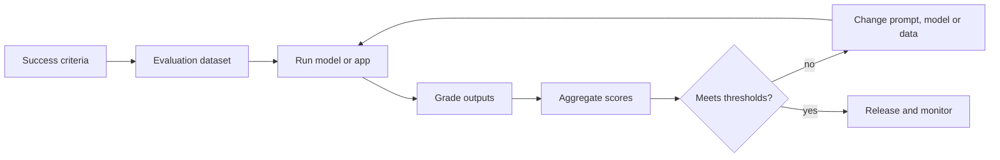

## Beginner-friendly explanation

Think of a cooking competition. Judges do not taste one spoonful and declare a winner. They agree on criteria in advance, such as taste, presentation and following the recipe, taste many dishes, and give scores that can be compared.

LLM evaluation is that judging process for AI answers. Because a model's answers vary, you agree what "good" means, collect many test inputs, score the answers on each criterion, and compare totals between versions.

## Technical explanation

### The evaluation loop



### Success criteria

Good criteria are **specific and measurable**: "at least 90% of answers contain the correct refund amount" rather than "answers are accurate". Cover several dimensions:

| Dimension | Example criterion |
|---|---|
| Correctness | Contains the right facts |
| Faithfulness | No claims beyond the provided source |
| Instruction following | Correct format, language and length |
| Safety | Refuses disallowed requests |
| Tone | Polite and on-brand |
| Latency and cost | Under 3 seconds, under a token budget |

### Evaluation datasets

Gather inputs from real usage where privacy rules allow, plus edge cases (empty, very long, other languages) and adversarial cases (injection, harmful requests). Each case records the input and what a good output must contain or avoid. Keep a held-out set so you do not tune the prompt to a few examples.

### Grading methods

| Method | Strength | Weakness |
|---|---|---|
| Code-based (exact match, regex, schema, numeric) | Fast, cheap, reliable | Only for checkable properties |
| Human review | Best for nuance | Slow, expensive, can be inconsistent |
| LLM-as-judge with a rubric | Scales to open-ended text | Biases; needs calibration against humans |

Common model-grader biases include preferring longer answers and preferring the answer shown first in a pairwise comparison.

### Reporting

Report per-criterion pass rates and averages, compare with the baseline, and look at failing cases, not only totals. Because outputs vary, run important evaluations more than once.

## Code examples

A minimal evaluation harness in Python with a code-based grader:

```python
cases = [
    {"input": "Where is order 5521?", "must_contain": "5521"},
    {"input": "Cancel order 9910 please", "must_contain": "9910"},
    {"input": "", "must_contain": "order number"},
]

def grade(output: str, case: dict) -> bool:
    return case["must_contain"].lower() in output.lower() and len(output.split()) <= 120

results = [grade(run_assistant(c["input"]), c) for c in cases]
print(f"pass rate: {sum(results)}/{len(results)} = {sum(results) / len(results):.0%}")
```

`run_assistant` is your application's function that calls the model.

## Expected output

```text
pass rate: 2/3 = 67%
```

The empty input case failed, so the assistant did not ask for an order number. With a release threshold of 95%, this version is blocked, and the failing case tells you what to fix.

## Real-world example

A legal-tech team switched to a newer model because it led a public benchmark. Their customers' contract summaries became longer and occasionally dropped termination clauses. The team had no product-specific evaluation, so the problem surfaced through complaints. They built a 300-case dataset from anonymised contracts, with required clauses per case, used code checks for clause presence and a calibrated model grader for faithfulness, and now compare every model or prompt change against the baseline before release.

## Common mistakes

- **Vague criteria** like "high quality".
- **Tiny or unrepresentative datasets**, often only happy-path questions.
- **Trusting an uncalibrated model grader.**
- **Looking only at the average** and never at failing examples.
- **Overfitting the prompt** to the evaluation set without a held-out set.

## Troubleshooting

- **Scores vary run to run.** Run several times and report the range; check the model version is pinned.
- **Graders disagree.** Make the rubric more specific with examples of each score.

## Key takeaways summary

Define measurable criteria, build a representative dataset, grade with code first and calibrated judges second, and compare versions on aggregate scores. For retrieval-based systems, continue with [RAG evaluation](/learn/specialist/rag-evaluation).
