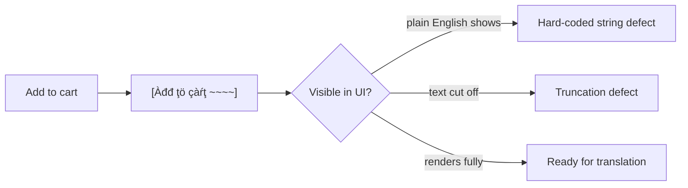

## Beginner-friendly explanation

Think of building a house where every light socket accepts any country's plug through a simple adapter. Designing the sockets that way is **internationalization**. Fitting the right adapters, signs and furniture when someone from Japan moves in is **localization**.

Software works the same way. Internationalization (often written i18n, because there are 18 letters between the i and the n) prepares the product for any language and region. Localization (l10n) adapts it to one specific place. Testers check both.

## Technical explanation

A **locale** identifies a language and region, such as `en-US`, `en-GB`, `fr-CA` or `ar-EG`. Many formats depend on it.

| Item | en-US | de-DE | hi-IN |
|---|---|---|---|
| Number | 1,234,567.89 | 1.234.567,89 | 12,34,567.89 |
| Date (short) | 3/14/2026 | 14.3.2026 | 14/3/2026 |
| Currency | $1,234.50 | 1.234,50 € | ₹1,234.50 |

Exact output can vary slightly by library and CLDR version, so assert on what the locale data says, not on what you expect from memory.

### What to test for internationalization

- **Externalised strings:** no hard-coded text in code or images.
- **Unicode (UTF-8) end to end:** forms, database, APIs, exports and emails keep characters intact.
- **Text expansion:** translations can be much longer than English, especially for short labels.
- **No string concatenation:** "You have " + n + " items" breaks in languages with different word order.
- **Plurals and gender** handled by rules, not `if (n == 1)`.
- **Sorting and search:** alphabetical order differs between languages; accent-insensitive search may be expected.
- **Time zones:** store times in UTC and display in the user's zone.
- **Right-to-left (RTL):** Arabic and Hebrew need mirrored layouts and `dir="rtl"`.

### What to test for localization

- Translation accuracy, consistency and tone, ideally reviewed by native speakers.
- Local formats, currency, address and phone formats, units and legal text.
- Culturally appropriate images, colours and examples.

### Pseudo-localization



## Code examples

```javascript
const n = 1234567.891;
for (const locale of ['en-US', 'de-DE', 'hi-IN']) {
  console.log(locale, new Intl.NumberFormat(locale).format(n));
}
const plural = new Intl.PluralRules('ar-EG');
console.log([0, 1, 2, 5, 11, 100].map((x) => plural.select(x)));
```

## Expected output

```text
en-US 1,234,567.891
de-DE 1.234.567,891
hi-IN 12,34,567.891
[ 'zero', 'one', 'two', 'few', 'many', 'other' ]
```

Arabic needs six different message variants for those counts, where English needs two.

## Real-world example

A fitness app launched in Germany and France. In English the button "Start" fitted perfectly; the German translation was much longer and the label was cut off on small phones. The app also built sentences like "Workout " + name + " completed", which produced awkward grammar in French. A pseudo-localization run before translation would have shown both problems in an afternoon. The team added pseudo-locale screenshots to their regression checks.

## Common mistakes

- **Testing only in English** and assuming translations will fit.
- **Hard-coding date, number or currency formats.**
- **Using simple test names** like "John Smith" and never names with accents, apostrophes or non-Latin scripts.
- **Mirroring everything in RTL**, including phone numbers and media controls that should stay left to right.
- **Confusing language with country**, for example assuming every Spanish speaker uses euros.

## Troubleshooting

- **Garbled characters.** Find where the encoding changes: form, API, database or export.
- **Translation missing.** Check the fallback chain, for example `fr-CA` falls back to `fr`, then the default.

## Key takeaways summary

Internationalization makes software locale-ready; localization makes it feel native. Test formats, plurals, encodings, text expansion and RTL, and use pseudo-localization early. Related: [cross-browser testing](/learn/specialist/cross-browser-testing).
