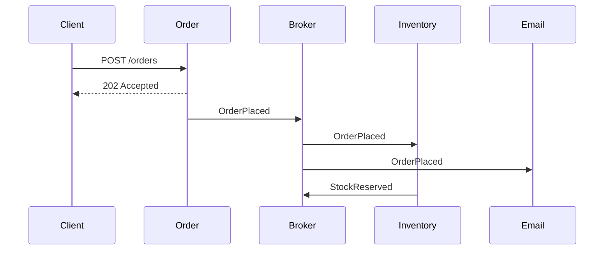

## Beginner-friendly explanation

Picture a restaurant kitchen. Instead of one cook doing everything, there is a grill station, a salad station and a dessert station. Orders are written on tickets and passed along. Each station can be improved on its own, but a lost ticket, a ticket read twice or a station that changes how it reads tickets can ruin a meal.

Microservices are those stations: small, separately deployed services. Event-driven systems pass "tickets", messages such as "order placed", through a message broker. Testing must check each station and, just as importantly, the tickets between them.

## Technical explanation

- **Microservice:** a small service that owns one business capability and its own data, deployed independently.
- **Synchronous communication:** one service calls another over HTTP or gRPC and waits.
- **Event-driven communication:** a producer publishes an event to a broker such as Kafka or RabbitMQ; consumers react later. The producer does not know who listens.
- **Eventual consistency:** data across services becomes consistent after a short delay, not instantly.



### Test levels

| Level | What it covers | Typical tools |
|---|---|---|
| Unit | Logic inside one service | JUnit, pytest, Jest |
| Component | One service with dependencies faked | WireMock, in-memory broker |
| Integration | Service with real database or broker | Testcontainers |
| Contract | Agreement between consumer and provider | Pact |
| End-to-end | A few critical journeys across services | Playwright, REST Assured |

### Event-specific risks to test

- **Duplicates:** at-least-once delivery means consumers must be idempotent.
- **Ordering:** events may arrive out of order across partitions or retries.
- **Poison messages:** a malformed message must go to a dead-letter queue, not block the queue forever.
- **Schema evolution:** a new field must not break old consumers.
- **Downstream outages:** retries with backoff, timeouts and circuit breakers.
- **Observability:** a correlation or trace id follows the request through every service.

## Code examples

A polling assertion in Java with Awaitility:

```java
placeOrder("order-123");

await().atMost(Duration.ofSeconds(10))
       .pollInterval(Duration.ofMillis(200))
       .untilAsserted(() ->
           assertThat(inventoryClient.reservationFor("order-123"))
               .isEqualTo("RESERVED"));
```

## Expected output

When the event is processed in time, the test passes as soon as the reservation appears. If not, it fails with a clear timeout message:

```text
org.awaitility.core.ConditionTimeoutException: Assertion condition defined as a lambda expression
expected: "RESERVED" but was: null within 10 seconds.
```

## Step-by-step walkthrough

1. Map services, APIs, events and which service owns which data.
2. Agree contracts for each API and event schema, and verify them in CI.
3. Test each service in isolation with test doubles.
4. Add integration tests with real infrastructure in containers.
5. Test failure paths: duplicates, delays, outages, bad messages.
6. Keep a thin set of end-to-end tests for the top journeys and check traces when they fail.

## Real-world example

A food delivery team split checkout into order, payment and notification services. After a broker restart, some PaymentCaptured events were redelivered and a few customers received two confirmation messages, and one was charged twice by a downstream refund job. Tests had covered only the single-delivery path. The team added duplicate-delivery tests for every consumer and stored processed event ids.

## Common mistakes

- **Relying on many end-to-end tests** across a dozen services.
- **Fixed sleeps** for asynchronous results.
- **Testing only the happy path** with exactly-once, in-order delivery.
- **Mocking everything** so contracts drift unnoticed.
- **No correlation ids**, making failures impossible to trace.

## Troubleshooting

- **Message never consumed.** Check topic or queue names, consumer group, and the dead-letter queue.
- **Test passes alone but fails in a suite.** Isolate data with unique ids per test.

## Key takeaways summary

Test each service deeply, protect the boundaries with contracts, assert asynchronously and expect failure. Continue with [chaos engineering basics](/learn/specialist/chaos-engineering-basics).
