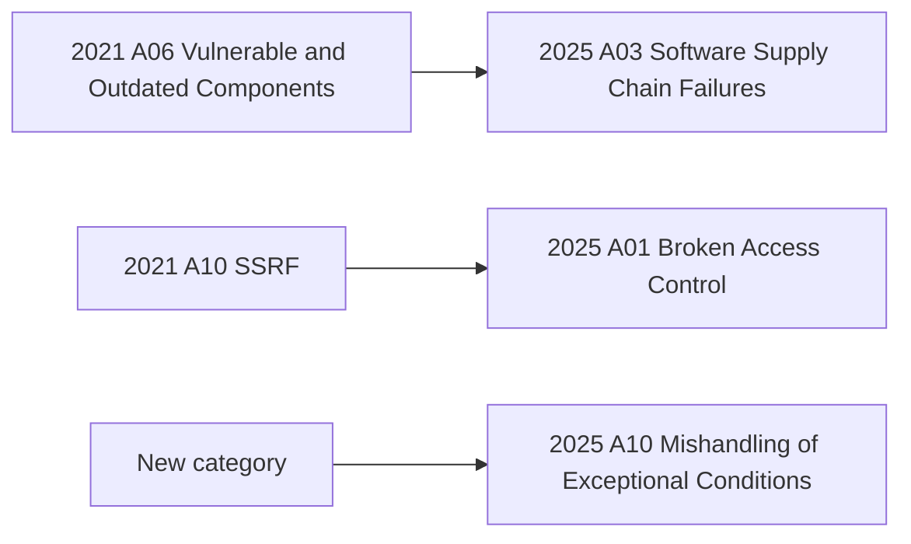

## Beginner-friendly explanation

Think of a list of the ten most common ways houses get burgled: unlocked back doors, keys under the mat, weak window latches. A home inspector uses that list so they never forget to check the usual weak spots, even though burglars sometimes try something new.

The OWASP Top 10 is that list for web applications. OWASP (the Open Worldwide Application Security Project) is a non-profit community. Every few years it publishes the ten most critical risk categories, and testers use it to make sure they cover the usual weak spots.

## Technical explanation

The current edition is **OWASP Top 10:2025**. Use it only in a lab or on systems you are authorized to test.

| ID | Category | What it means | Authorized test idea |
|---|---|---|---|
| A01:2025 | Broken Access Control | Users act outside their permissions; includes SSRF | Request another user's record by id; call an admin API as a normal user |
| A02:2025 | Security Misconfiguration | Unsafe defaults, verbose errors, open cloud storage, missing headers | Check for default accounts, directory listings, debug pages and missing security headers |
| A03:2025 | Software Supply Chain Failures | Vulnerable or compromised dependencies, build tools and pipelines | Run a dependency audit; check that builds use pinned, verified packages |
| A04:2025 | Cryptographic Failures | Sensitive data unprotected in transit or at rest, weak algorithms | Confirm HTTPS everywhere and that passwords are never returned or logged |
| A05:2025 | Injection | Untrusted input interpreted as code or commands (SQL, OS, XSS) | Send a single quote and an HTML script tag as harmless test strings; confirm they are rejected or safely encoded |
| A06:2025 | Insecure Design | Missing security controls in the design itself | Look for business-logic abuse, such as reusing a single-use coupon many times |
| A07:2025 | Authentication Failures | Weak login, session or credential handling | Test lockout, rate limiting, session expiry and token invalidation on logout |
| A08:2025 | Software or Data Integrity Failures | Trusting data or code without verifying integrity | Tamper with a signed token or a hidden field and confirm the server rejects it |
| A09:2025 | Security Logging and Alerting Failures | Attacks are not logged or nobody is alerted | Trigger failed logins in the lab and check that they are logged and alerted |
| A10:2025 | Mishandling of Exceptional Conditions | Errors handled badly, the system fails open or leaks details | Force timeouts and malformed input; check for safe failure and generic errors |

### What changed since 2021



Security Misconfiguration moved from A05 to A02, and Injection dropped from A03 to A05.

## Code examples

A safe check for reflected input in your own lab application:

```bash
curl -s "http://localhost:3000/search?q=%3Cb%3Etest%3C%2Fb%3E" | grep -o "&lt;b&gt;test"
```

## Expected output

```text
&lt;b&gt;test
```

The search term is HTML-encoded, so a browser shows it as text instead of running it as markup. If the raw `<b>test</b>` appears in the page instead, user input reaches HTML unencoded, which is a likely A05 Injection (cross-site scripting) issue.

## Step-by-step walkthrough

1. Confirm the written scope and the test environment.
2. Map each feature to the categories it touches; a file upload touches A01, A05 and A10, for example.
3. Run automated checks: a dependency audit for A03 and a DAST scan for A02 and A05.
4. Do manual tests for A01, A06 and A07, which tools rarely catch well.
5. Report each finding with its OWASP category, impact, steps and evidence.

## Real-world example

A team running an online learning platform added a "import profile picture from URL" feature. In an authorized staging test, a tester entered the address of an internal admin service instead of an image URL, and the server fetched it. That is server-side request forgery, which the 2025 edition files under A01 Broken Access Control. The fix restricted fetches to an allowlist of external hosts, and the tester added the case to the regression suite.

## Common mistakes

- **Using an outdated edition** (2017 or 2021 numbering) in reports and training.
- **Treating the list as complete.** It is an awareness document; use ASVS for full requirements.
- **Only running a scanner.** A01 and A06 usually need a human who understands the business rules.
- **Testing payloads on systems you do not own** or outside the agreed scope.
- **Reporting without impact.** "XSS found" is weaker than "a script in a review runs in every viewer's session".

## Troubleshooting

- **Unsure which category fits.** Pick the one that describes the root cause; A01 versus A07 depends on whether the user was correctly identified but over-permitted (A01) or wrongly identified (A07).

## Key takeaways summary

The OWASP Top 10:2025 gives you ten risk areas to cover in every security test plan. Learn the categories, turn each into concrete test ideas, practise on a local lab such as Juice Shop, and report with the category name. Review the basics in [security testing fundamentals](/learn/specialist/security-testing-fundamentals).
