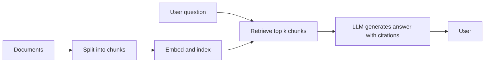

## Beginner-friendly explanation

Imagine an open-book exam. A student first has to find the right pages in the textbook, then write an answer using those pages. A bad answer can have two causes: the student looked at the wrong pages, or found the right pages and still wrote something different.

Retrieval-augmented generation (RAG) works the same way. The system first **retrieves** relevant pieces of your documents, then a language model **generates** an answer from them. Evaluating RAG means checking both steps: were the right pages found, and was the answer faithful to them?

## Technical explanation

### The pipeline



Each stage can fail: documents missing or outdated, chunks that split key sentences, embeddings that miss domain words, too few or too many chunks, or a model that ignores the context.

### Retrieval metrics

Build a dataset of questions labelled with the relevant chunk or document ids.

| Metric | Meaning |
|---|---|
| Recall at k | Share of relevant chunks that appear in the top k |
| Precision at k | Share of the top k chunks that are relevant |
| Hit rate at k | Whether at least one relevant chunk is in the top k |
| MRR (mean reciprocal rank) | Average of 1 / rank of the first relevant chunk |

Worked example: relevant = {A, B}, retrieved = [C, A, D, E, B].

| Metric | Calculation | Value |
|---|---|---|
| Recall at 3 | 1 relevant found / 2 relevant | 0.5 |
| Precision at 3 | 1 relevant / 3 retrieved | 0.33 |
| Recall at 5 | 2 / 2 | 1.0 |
| Reciprocal rank | first relevant at rank 2, so 1/2 | 0.5 |

### Generation metrics

- **Faithfulness (groundedness):** each claim in the answer is supported by the retrieved context.
- **Answer relevance:** the answer addresses the question asked.
- **Correctness:** the answer matches a reference answer.
- **Citation accuracy:** cited sources really contain the cited claim.
- **Abstention:** for unanswerable questions, the system says it does not know.

Faithfulness and relevance are usually graded by a calibrated model grader or humans, often by splitting the answer into claims and checking each one. Libraries such as Ragas implement these metrics; check their documentation for the current definitions, as they evolve.

### Security

Retrieved documents are untrusted input. A document containing hidden instructions can cause indirect prompt injection, and retrieval must respect permissions so users never get chunks from documents they cannot access.

## Code examples

```python
def recall_at_k(relevant: set, retrieved: list, k: int) -> float:
    return len(relevant & set(retrieved[:k])) / len(relevant)

def reciprocal_rank(relevant: set, retrieved: list) -> float:
    for rank, chunk in enumerate(retrieved, start=1):
        if chunk in relevant:
            return 1 / rank
    return 0.0

relevant, retrieved = {"A", "B"}, ["C", "A", "D", "E", "B"]
print(recall_at_k(relevant, retrieved, 3), recall_at_k(relevant, retrieved, 5), reciprocal_rank(relevant, retrieved))
```

## Expected output

```text
0.5 1.0 0.5
```

Averaging these values across the whole question set gives the retrieval scores you track release over release.

## Real-world example

An internal IT help assistant answered "How many days of leave can I carry over?" with the wrong number. Logs showed the correct HR policy chunk was never retrieved: the document used the phrase "annual entitlement rollover" and the chunk boundary split the number from its heading. Retrieval recall on a 150-question labelled set was low for HR questions. The team changed chunking to keep headings with their paragraphs and added keyword search alongside embeddings. Recall improved on the same dataset, and faithfulness checks confirmed the answers now followed the retrieved policy.

## Common mistakes

- **Evaluating only the final answer**, so retrieval and generation problems look the same.
- **No unanswerable questions** in the dataset.
- **Ignoring document freshness**, so faithful answers repeat outdated policies.
- **Not logging retrieved chunks**, making diagnosis impossible.
- **Skipping permission checks** in retrieval.

## Troubleshooting

- **Low recall.** Check ingestion, chunk size and overlap, embeddings and k.
- **Good recall but unfaithful answers.** Tighten the prompt to answer only from context, reduce noisy chunks, and require citations.

## Key takeaways summary

Evaluate RAG in two halves: did retrieval find the right context, and did generation stay faithful to it? Label your questions, include unanswerable ones and trace every failure to its stage. Review the foundations in [LLM evaluation](/learn/specialist/llm-evaluation).
