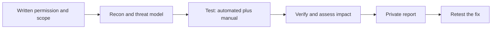

## Beginner-friendly explanation

Imagine you are hired to check the locks of an office building. You walk around with the owner's permission, try the doors, check whether the back window closes, and see whether a visitor badge also opens the server room. You do not break in at night, and you do not try the building next door. When you find a weak lock, you tell the owner privately.

Security testing is the same idea for software. You look for ways an attacker could read data they should not see, change data they should not touch, or knock the system over, and you do it only with permission.

## Technical explanation

### The CIA triad

| Property | Meaning | Example test idea |
|---|---|---|
| Confidentiality | Only authorized parties can read data | User B requests user A's order by id |
| Integrity | Data changes only through authorized actions | Change the price field in a checkout request |
| Availability | The service stays usable | Send 100 login attempts per second and check rate limiting |

### Types of security testing

- **Vulnerability scanning:** automated tools check for known weaknesses, such as outdated server versions or missing security headers.
- **SAST (static application security testing):** analyses source code or bytecode without running it. Good for early feedback in CI.
- **DAST (dynamic application security testing):** sends crafted requests to the running application. OWASP ZAP is a common open-source example.
- **SCA (software composition analysis):** lists third-party libraries and flags those with known vulnerabilities.
- **Penetration testing:** skilled humans try to exploit and chain weaknesses inside an agreed scope to show real business impact.
- **Security code review and threat modelling:** finding design flaws before code exists, often by asking "what can go wrong?" for each data flow.

### Authorization and ethics

Professional security testing always has a written **scope**: target hosts, environments, allowed techniques, time window and contacts. Testing outside it can break laws and contracts even if your intent is good. For learning, use intentionally vulnerable apps you run locally, such as OWASP Juice Shop.



### Checks any functional tester can do

1. **Access control:** change ids in URLs and request bodies; call admin endpoints as a normal user.
2. **Authentication:** generic login errors, lockout or rate limiting, session expiry after logout.
3. **Input handling:** special characters such as `'`, `"`, `<` and very long values must be rejected or safely encoded, never executed.
4. **Error handling:** no stack traces, SQL or version numbers in responses.
5. **Transport and cookies:** HTTPS everywhere; session cookies marked `Secure`, `HttpOnly` and with a suitable `SameSite` value.

## Code examples

Replaying a request as a different user against a local practice app with curl:

```bash
# Logged in as user B (token for B), asking for an order that belongs to user A
curl -i http://localhost:3000/api/orders/101 \
  -H "Authorization: Bearer $TOKEN_USER_B"
```

## Expected output

A secure application answers with `403 Forbidden` or `404 Not Found` and no order data:

```text
HTTP/1.1 404 Not Found
Content-Type: application/json

{"error":"Order not found"}
```

If you get `200 OK` with user A's order, you have found broken access control. Stop, record the evidence and report it.

## Real-world example

A team building a clinic booking portal ran functional tests on every screen but never swapped user tokens. During an authorized test in the staging environment, a tester logged in as patient B and replayed patient A's appointment request. The API returned A's appointment, including the reason for the visit. The UI never showed a link to it, so nobody had noticed. The fix added an ownership check on the server, and the team added "replay with another user's token" to their API regression suite.

## Common mistakes

- **Testing without written permission**, or drifting outside the agreed scope.
- **Trusting the UI.** Hidden buttons are not security; attackers call the API directly.
- **Relying only on a scanner.** Scanners miss business-logic and access-control flaws.
- **Reporting in public channels** or including real personal data in tickets.
- **Treating security as a final phase** instead of building checks into every sprint.

## Troubleshooting

- **Scanner reports hundreds of findings.** Triage by severity and confirm each one manually; many are false positives or low risk.
- **Cannot reproduce a finding.** Record the exact request, headers, user and time; session state often matters.

## Key takeaways summary

Security testing asks how someone could read, change or break what they should not. Get permission, think in CIA terms, combine automated tools with manual checks, and report privately. Next, learn the most common web risks in [OWASP Top 10 for testers](/learn/specialist/owasp-top-10-for-testers).
