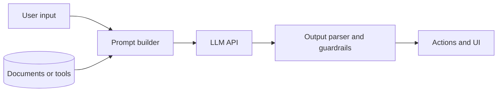

## Beginner-friendly explanation

Imagine testing a calculator versus testing a new employee who answers customer emails. The calculator always gives 4 for 2 + 2, so you check the exact answer. The employee writes a slightly different email each time. You cannot demand identical wording; you check whether each email is correct, polite, complete and safe, and you look at many emails, not just one.

Applications built on large language models (LLMs) behave like that employee. Testing them means checking the qualities of answers across many examples, while still testing the ordinary code around the model like any other software.

## Technical explanation

### Anatomy of an AI application



Only the model call is non-deterministic. Input validation, prompt building, tools, parsing, permissions and the UI are normal code.

### What to test

| Area | Example checks |
|---|---|
| Functional quality | Correct facts, follows instructions, right format |
| Robustness | Typos, other languages, very long input, empty input |
| Safety | Refuses harmful requests, no toxic or biased output |
| Security | Prompt injection, data leakage, excessive agency of tools |
| Grounding | Does not invent facts (hallucination) |
| Non-functional | Latency, token cost, rate limits, timeouts |

### Techniques

- **Property-based assertions:** valid JSON, required fields, length limits, contains the order number, no email addresses of other people.
- **Evaluation datasets:** a set of inputs with expected properties or reference answers, scored automatically, by a model-based grader, or by humans. See [LLM evaluation](/learn/specialist/llm-evaluation).
- **Mocked model responses** for deterministic tests of the surrounding code.
- **Red teaming:** authorized adversarial testing for safety and injection, guided by the OWASP Top 10 for LLM Applications.
- **Monitoring:** sample production conversations, user feedback and cost, because behaviour can change with model updates.

Many model APIs let you set parameters such as temperature, which reduces but does not eliminate variation.

## Code examples

A pytest check with the model mocked, testing only the application's parsing and safety logic:

```python
import json

def parse_reply(raw: str) -> dict:
    data = json.loads(raw)
    if data.get("action") == "refund" and data.get("amount", 0) > 100:
        data["needs_human_approval"] = True
    return data

def test_large_refund_requires_approval():
    fake_model_output = '{"action": "refund", "amount": 250}'
    assert parse_reply(fake_model_output)["needs_human_approval"] is True
```

## Expected output

```text
tests/test_reply.py::test_large_refund_requires_approval PASSED
```

This test is fully stable because the model is not called. Model quality is checked separately by evaluations that pass on an aggregate score.

## Real-world example

A retail team launched a chatbot that answered return-policy questions. Manual testers tried a few questions and the answers looked good. After launch, some customers asked about items bought in a sale, and the bot confidently invented a 60-day return window that did not exist. The team built an evaluation dataset of 200 real questions, with the policy facts each answer must contain, connected the bot to the official policy document, and now run the dataset before each prompt or model change.

## Common mistakes

- **Exact-match assertions** on model text.
- **Testing a handful of examples** and generalising.
- **Trusting the prompt for security** instead of enforcing permissions in code.
- **Ignoring model or prompt changes** as regression risks.
- **Forgetting cost and latency**, which can make a correct feature unusable.

## Troubleshooting

- **Tests flip between pass and fail.** Move model-dependent checks into evaluations with thresholds; mock the model in unit tests.
- **Scores drop after a release.** Compare model version, prompt and retrieved data between runs.

## Key takeaways summary

Test the code around the model normally, evaluate the model's behaviour over datasets with clear properties, attack it safely for injection and leakage, and keep monitoring after release. Continue with [LLM evaluation](/learn/specialist/llm-evaluation) and [RAG evaluation](/learn/specialist/rag-evaluation).
